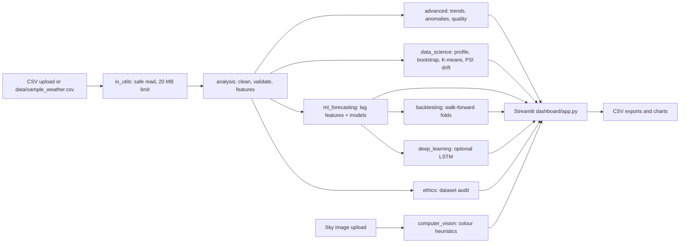
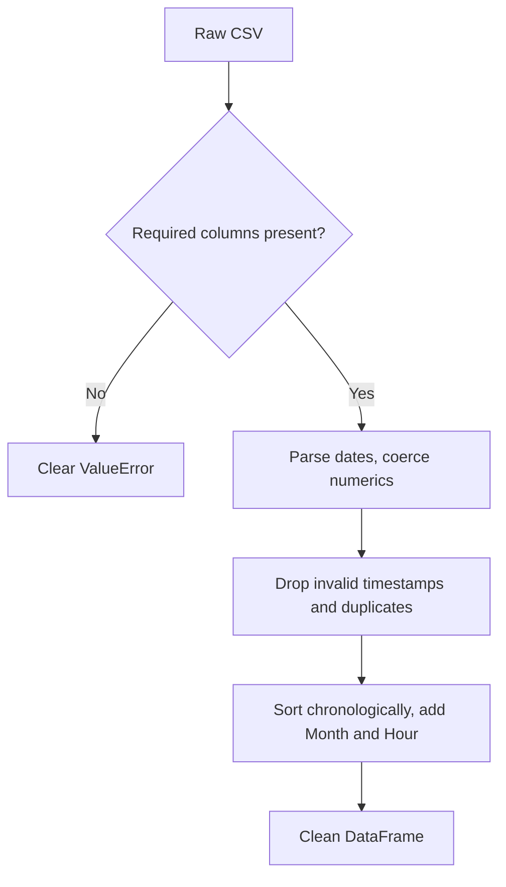
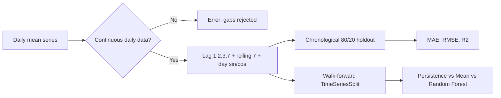
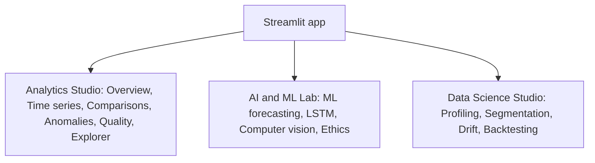

# Harpreet Singh — Enterprise Data Science & AI Weather Intelligence

**Author: Harpreet Singh** | Professional Python Data Analytics + ML + Deep Learning + Computer Vision + Responsible AI portfolio.

## Advanced Data Science upgrades (new)
- Statistical profiling, percentile distributions, skewness, missingness, violin charts
- Bootstrap mean confidence intervals with autocorrelation caveats
- Unsupervised K-means weather segmentation with silhouette evaluation
- Data drift monitoring with Population Stability Index (PSI)
- Walk-forward time-series validation with persistence/mean/Random Forest baselines, fold-level MAE and RMSE, CSV exports
- New Streamlit Data Science Studio with four interactive tabs
- Automated tests and `docs/DATA_SCIENCE_METHODOLOGY.md`

## Architecture


## Data pipeline


## Forecasting and validation flow


## Dashboard modules


## Features
- Streamlit + Plotly interactive dashboard: trends, comparisons, anomalies, correlation, data quality, CSV exports
- Machine learning: lag-based Random Forest, Histogram Gradient Boosting and mean baseline; chronological 80/20 test split; MAE, RMSE, R², next-day experimental estimate
- Deep learning: optional TensorFlow LSTM with train-only normalization and temporal holdout
- Computer vision: upload sky photos and explore **unvalidated color heuristics** (not real cloud classification)
- AI ethics: provenance/quality audit, model card, safety and fairness considerations
- Pytest and GitHub Actions CI; sample synthetic weather data and Jupyter notebook

## Install (Python 3.11 recommended)
```bash
python -m venv .venv
# Windows PowerShell: .venv\Scripts\Activate.ps1
# Linux/macOS: source .venv/bin/activate
python -m pip install -r requirements.txt
python -m streamlit run dashboard/app.py
```
Optional deep learning: `python -m pip install -r requirements-deep-learning.txt` (TensorFlow platform compatibility varies).
Run tests: `python -m pytest -q`.

## CSV format
Columns: `Date/Time`, `Weather`, `Wind Speed_km/h`; for ML include `Temp_C` or other selected target. Optional `Rel Hum_%`, `Visibility_km`, `Press_kPa`. Example dataset: `data/sample_weather.csv`.
For ML, timestamps must form a **continuous daily series** after resampling. Missing dates cause a clear error rather than silent imputation.

## Project structure
- `dashboard/app.py`: dashboard and AI lab
- `src/analysis.py`, `src/advanced.py`: preparation and descriptive analytics
- `src/ml_forecasting.py`: supervised lag forecasting and evaluation
- `src/deep_learning.py`: optional TensorFlow LSTM
- `src/computer_vision.py`: exploratory image-color analysis
- `src/ethics.py`: dataset audit
- `docs/MODEL_CARD.md`, `docs/AI_ETHICS.md`: limitations, safety, governance
- `tests/`: automated tests
- `notebooks/`: data exploration

## Important limitations
Synthetic demo data; predictions are **not official forecasts**. CV results are **not validated cloud measurements**. No live weather API, safety alerts or guaranteed accuracy. No hosted deployment is included. Do not use for safety-critical decisions.

## License
MIT. Copyright Harpreet Singh.
